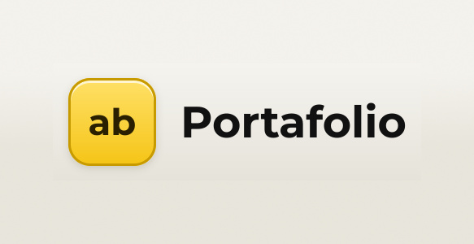

# Portafolio

Sitio web personal construído con React + Vite, publicado en GitHub Pages con GitHub Actions.

## Uso

~~~
npm install
npm run dev        # desarrollo
npm run build      # type-check + build en dist/
npm run preview    # probar el build localmente
~~~

## Contenido

Todo  texto e imágenes se configuran en `src/data/content.ts`.

Los colores y la tipografía están en `src/styles/tokens.css` (incluye modo oscuro automático).

Las imágenes se alocan en `public/images/`. Vite los copia al build, así que en el entorno de GitHub Pages el directorio `images/` queda en la raíz del sitio.

`src: ''` = sin imagen: se mantiene el placeholder `.ph`.

## Mockup

En el directorio `mockup/` se encuentra la referencia de diseño original del sitio. En un principio, se tomaron de allí los valores exactos de color, tipografía, espaciado y disposición de los elementos.

Hoy en día, archivado.

## Despliegue

Cada push a `main` ejecuta `.github/workflows/deploy.yml` y publica `dist/` a GitHub Pages.

